<div align="center">


<p align="center">
  <a href="https://pypi.org/project/librarian-code/"></a>
  <a href="https://linkedin.com/in/neel-sorathiya"></a>
  <a href="mailto:neel5sorathiya@gmail.com"></a>
  <a href="https://github.com/Humble-Librarian"></a>
</p>

<p align="center">
  <sub>Building local-first developer tools, neuro-symbolic fault diagnostics, and interpretable machine learning systems.</sub>
</p>

</div>

---

### Core Focus

* **Memory and Retrieval:** Building AST-based context indexes and local vector search tools to prevent context drift in coding agents.
* **Neuro-Symbolic Systems:** Combining formal Horn-clause logic with statistical decision models for verifiable, zero-hallucination diagnostics.
* **High-Throughput Clients:** Writing zero-overhead browser extensions and native desktop tools that keep memory low on large workloads.

---

### Flagship Systems

<table>
  <tr>
    <td width="50%" valign="top">
      <h4><a href="https://github.com/Humble-Librarian/Librarian-Code">Librarian-Code</a> <code>PyPI</code></h4>
      <p>A local-first CLI coding agent that builds a persistent memory index of project edits. Adjusts confidence scores across sessions and switches between LLM providers during rate limits.</p>
      <p><b>Stack:</b> Python, Groq API, FAISS, AST Parsing</p>
    </td>
    <td width="50%" valign="top">
      <h4><a href="https://github.com/Humble-Librarian/NetVerity">NetVerity</a></h4>
      <p>A neuro-symbolic network fault diagnosis engine. Combines 4-valued Horn-clause logic with non-autoregressive decision models to isolate failures without hallucination or GPU requirements.</p>
      <p><b>Stack:</b> Python, Horn-Clause Logic, Breadth-First State Search</p>
    </td>
  </tr>
  <tr>
    <td width="50%" valign="top">
      <h4><a href="https://github.com/Humble-Librarian/Tactical-CBM">Tactical-CBM</a></h4>
      <p>An explainable Concept Bottleneck Model and real-time tactical evaluation engine for football analytics, built for zero-copy inference on consumer hardware using tracking data.</p>
      <p><b>Stack:</b> PyTorch, C++17, WebAssembly, StatsBomb 360</p>
    </td>
    <td width="50%" valign="top">
      <h4><a href="https://github.com/Humble-Librarian/Virdixt">Virdixt</a></h4>
      <p>An air-gapped multimodal financial intelligence engine. Combines FinBERT ONNX pipelines, RST discourse parsing, and deterministic accounting checks with sub-10ms latency.</p>
      <p><b>Stack:</b> FinBERT, ONNX Runtime, FastAPI, RapidOCR</p>
    </td>
  </tr>
  <tr>
    <td width="50%" valign="top">
      <h4><a href="https://github.com/Humble-Librarian/PDF-DARKMODE">PDF Dark Mode Reader</a></h4>
      <p>A Firefox extension for dark-mode PDF reading. Implements a smart HSL engine and asynchronous viewport virtualization to drop memory use from 2.1 GB to 80 MB on 250+ page files.</p>
      <p><b>Stack:</b> JavaScript, Manifest V3, Viewport Virtualization</p>
    </td>
    <td width="50%" valign="top">
      <h4><a href="https://github.com/Humble-Librarian/RAG-Pipeline-Debugger-Visualizer">RAG Pipeline Debugger</a></h4>
      <p>A VS Code extension to inspect local ChromaDB vector databases, test document chunking, and isolate near-miss retrieval candidates falling just below similarity thresholds.</p>
      <p><b>Stack:</b> TypeScript, VS Code Extension API, ChromaDB</p>
    </td>
  </tr>
</table>

---

### Technical Capabilities

```toml
[runtimes_and_logic]
components = ["Neuro-Symbolic Logic", "Horn-Clause Verification", "AST Chunking", "FAISS", "ChromaDB"]

[machine_learning]
frameworks = ["PyTorch", "ONNX Runtime", "LightGBM", "Scikit-Learn", "Optuna", "Concept Bottlenecks"]

[systems_and_backend]
services = ["Python", "FastAPI", "C++17", "TypeScript", "Node.js", "Docker", "Linux"]

[client_and_extensions]
tooling = ["Manifest V3 Extensions", "VS Code Extension API", "React", "Next.js", "Tailwind CSS"]
```

---

### GitHub Telemetry

<div align="center">


<br/>

<!-- Streak stats deployed via profile-assets workflow -->


<br/>

<!-- Activity graph generated via profile-assets workflow -->


</div>

---

### Achievements & Contribution Activity

<div align="center">

<!-- Trophies generated and hosted on output branch -->


<br/><br/>

<!-- Snake animation generated on output branch -->


</div>
