<div align="center">


<p align="center">
  <a href="https://pypi.org/project/librarian-code/"></a>
  <a href="https://linkedin.com/in/neel-sorathiya"></a>
  <a href="mailto:neel5sorathiya@gmail.com"></a>
  <a href="https://github.com/Humble-Librarian"></a>
</p>

<p align="center">
  <sub>Third-year Computer Engineering & Data Science student (8.78 CGPA). Building multi-engine compilers, deterministic neuro-symbolic fault diagnostics, and local-first agentic memory systems. ML Intern at SAP.</sub>
</p>

</div>

---

### 🐟 Living Koi Ecosystem (Activity-Driven Aquarium)

<div align="center">

<!-- Animated pixel-art koi pond powered by git-koi-aquarium workflow -->


<p align="center">
  <sub>Living pond generated from real commit velocity, streak continuity, and language distribution.</sub>
</p>

</div>

---

### ⚡ Flagship Systems & Published Works

<table>
  <!-- ROW 1: COMPILERS & CODING AGENTS -->
  <tr>
    <td width="50%" valign="top">
      <h4><a href="https://github.com/Humble-Librarian/CHUD">CHUD</a> <code>Custom Language & Compiler</code></h4>
      <p>A complete educational programming language and multi-engine compiler pipeline built from scratch with <b>zero external dependencies</b>. Features maximal-munch lexing, an LL(1) recursive-descent parser, dual CST/AST generation, and AST constant folding.</p>
      <p><b>Engines:</b> Tree-walk interpreter, slot-based bytecode VM, and 100% parity C99 AOT native compiler with an interactive browser AST studio.</p>
      <p><b>Stack:</b> Python 3.9+ · C99 Native AOT · Bytecode VM · AST Visualizer</p>
    </td>
    <td width="50%" valign="top">
      <h4><a href="https://github.com/Humble-Librarian/Librarian-Code">Librarian-Code</a> <code>PyPI Published</code></h4>
      <p>A local-first CLI coding agent with persistent capsule-based memory. Indexes project edits across sessions, adjusts confidence scores dynamically, and handles multi-provider LLM failover during API rate limits.</p>
      <p><b>Highlights:</b> Codebase-aware AST parsing, FAISS vector indexing, and local execution sandboxing with live diff previews.</p>
      <p><b>Stack:</b> Python · Groq API · FAISS · AST Parsing</p>
    </td>
  </tr>

  <!-- ROW 2: NEURO-SYMBOLIC & EXPLAINABLE ML -->
  <tr>
    <td width="50%" valign="top">
      <h4><a href="https://github.com/Humble-Librarian/NetVerity">NetVerity</a> <code>Neuro-Symbolic AI</code></h4>
      <p>A deterministic network fault diagnosis agent unifying 4-valued Horn-clause symbolic logic (Prolog) with non-autoregressive decision models and explicit breadth-first state space search.</p>
      <p><b>Highlights:</b> Generates formal contrastive explanations (<i>"Why fault X and not hypothesis Y?"</i>) with zero hallucination and <b>0 MB VRAM footprint</b> (CPU optimized).</p>
      <p><b>Stack:</b> Python 3.10+ · Prolog Horn Logic · BFS State Space Search</p>
    </td>
    <td width="50%" valign="top">
      <h4><a href="https://github.com/Humble-Librarian/Tactical-CBM">Tactical-CBM</a> <code>Explainable AI</code></h4>
      <p>An explainable Concept Bottleneck Model and real-time tactical evaluation engine for modern football built on StatsBomb 360 tracking data.</p>
      <p><b>Highlights:</b> Engineered for reproducible experimental rigor and zero-copy consumer hardware inference with C++17 and WebAssembly multi-runtime parity.</p>
      <p><b>Stack:</b> PyTorch · C++17 · WebAssembly · StatsBomb 360</p>
    </td>
  </tr>

  <!-- ROW 3: AIR-GAPPED FINTECH & HIGH-PERFORMANCE EXTENSIONS -->
  <tr>
    <td width="50%" valign="top">
      <h4><a href="https://github.com/Humble-Librarian/Virdixt">Virdixt</a> <code>Air-Gapped FinTech</code></h4>
      <p>An air-gapped multimodal financial intelligence and automated risk-routing engine combining FinBERT ONNX pipelines, RST discourse parsing, and deterministic accounting checks (Altman Z / Beneish M).</p>
      <p><b>Benchmarks:</b> Sub-10ms inference latency, <b>89.66%</b> negative recall, and <b>0.8926</b> Macro F1 score across unstructured filings.</p>
      <p><b>Stack:</b> FinBERT · ONNX Runtime · FastAPI · RapidOCR</p>
    </td>
    <td width="50%" valign="top">
      <h4><a href="https://github.com/Humble-Librarian/PDF-DARKMODE">PDF Dark Mode Reader</a> <code>Browser Extension</code></h4>
      <p>A Firefox extension for dark-mode PDF reading built with a smart HSL engine that preserves original image and diagram colors instead of a flat inversion filter.</p>
      <p><b>Optimization:</b> Slashed browser memory consumption from <b>2.1 GB → 80 MB</b> on 250+ page documents via asynchronous viewport virtualization.</p>
      <p><b>Stack:</b> JavaScript · Manifest V3 · GPU CSS Filters · Viewport Virtualization</p>
    </td>
  </tr>
</table>

---

### 🛠️ Languages & Technical Arsenal

```toml
[core_languages]
languages = ["Python", "C", "C++17", "TypeScript", "JavaScript", "Java", "SQL", "Prolog"]

[compilers_and_runtimes]
tooling = ["Bytecode VMs", "LL(1) Recursive Descent", "AST / CST Trees", "C99 Native AOT", "WebAssembly", "Linux", "Docker"]

[machine_learning_and_vision]
frameworks = ["PyTorch", "ONNX Runtime", "LightGBM", "Scikit-Learn", "Optuna", "OpenCV", "Concept Bottleneck Models"]

[agentic_and_logic]
components = ["Capsule Memory Architecture", "Horn-Clause Symbolic Logic", "FAISS", "ChromaDB", "AST Chunking", "Groq API"]

[clients_and_extensions]
systems = ["Manifest V3 (Browser Extensions)", "FastAPI", "React", "Next.js 14", "Tailwind CSS", "D3.js", "Node.js"]
```

---

### 📊 Engineering Telemetry & Activity Metrics

<div align="center">

<!-- GitHub Stats & Top Languages from High-Availability Mirror -->


<br/><br/>

<!-- Streak Stats Deployed Statically from output branch -->


<br/><br/>

<!-- Activity Graph Deployed Statically from output branch -->


</div>

---

### 🏆 Milestones & Contribution Activity

<div align="center">

<!-- GitHub Trophies Deployed Statically from output branch -->


<br/><br/>

<!-- Contribution Snake Animation Deployed from output branch -->


</div>

---

<div align="center">
  <code>"Every system I build remembers why it failed — that's how it gets better."</code>
</div>
